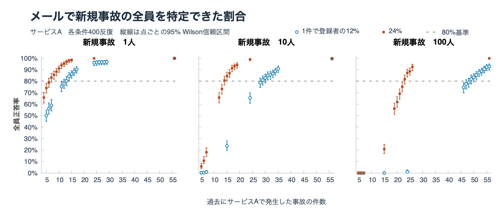

# 過去に何件の漏えいがあると、新規事故の全員を正しく特定できるか

架空のサービスAで、過去の漏えい1件が毎回、登録者の24%を無作為に含むと仮定した。新規の漏えい100人をメールで全員正しく特定できる確率について、80%到達を確認した最少の過去事故件数は**24件**だった。過去1件の規模を登録者の12%にすると**51件**になった。同じ過去履歴を別サービスBの初回漏えいに使うと、確認した全261条件で80%を下回った。

## 新規人数と、80%到達を確認した過去事故件数

Aの再漏えいを対象に、過去1件の人数と新規事故の人数を固定した。下表は、確認用400回のうち新規対象者全員を正答した回数と、その割合を示す。メールだけを使った場合と氏名＋メールを使った場合は、各反復の回答が一致した。

| 過去1件の人数（A登録者比） | 新規人数 | 到達を確認した最少件数 | 全員正答した回数 | 全員正答率 | 95%信頼区間 |
|---|---:|---:|---:|---:|---:|
| 4,399,320人（24%） | 1人 | 8件 | 342 / 400 | 85.50% | 81.71–88.61% |
| 同上 | 10人 | 15件 | 338 / 400 | 84.50% | 80.63–87.72% |
| 同上 | 100人 | 24件 | 349 / 400 | 87.25% | 83.62–90.17% |
| 2,199,660人（12%） | 1人 | 14件 | 337 / 400 | 84.25% | 80.36–87.49% |
| 同上 | 10人 | 31件 | 340 / 400 | 85.00% | 81.17–88.17% |
| 同上 | 100人 | 51件 | 341 / 400 | 85.25% | 81.44–88.39% |

「到達」は、その測定点の両側95% Wilson信頼区間の下限が80%以上の場合とした。たとえば24%・新規1人では、過去5件は296/400で未達、6件は315/400で判定保留、7件も333/400で判定保留、8件で初めて到達した。7件の推定値は83.25%だが、区間の下限は79.28%だった。表は実際に確認した点の最小値であり、区間の信頼水準は各点に対するものとして読む。



同じ抽出条件では、この確率を有限母集団の理論式でも計算できる。新規1・10・100人の順に、確率そのものが初めて80%以上になるのは、24%で過去6・14・23件、12%で13・30・48件だった。理論式は一人ひとりが過去の事故に一度でも登場する条件を数え、反復実験は有限回の抽選から区間の下限が80%に達した点を判定する。[理論値](boundary-theory.csv)・[計算式の実装](../scripts/check-boundary-theory.rb)

逆に過去の事故件数を固定すると、到達を確認できた最小の1件当たり人数は次のようになった。12%と24%の2規模を両方測定した件数から抜粋した。両規模の間や12%未満の境界は測っていない。

| 過去の事故件数 | 新規1人 | 新規10人 | 新規100人 |
|---:|---:|---:|---:|
| 15件 | 2,199,660人 | 4,399,320人 | 到達の確認なし |
| 24件 | 2,199,660人 | 4,399,320人 | 4,399,320人 |
| 56件 | 2,199,660人 | 2,199,660人 | 2,199,660人 |

## 何人を特定できたか

1件当たり24%、過去6件、新規100人で、400回の平均を比較した。メールでAの約80人を特定できても、**100人全員を特定できた回は0回**だった。Bでは平均40.45人が過去の事故にも登場したが、そのうちAと同じメールで照合できたのは平均20.07人だった。

| 新規事故 | 照合に使う項目 | 過去に登場した人数 | 正答人数 | 保留人数 | 誤特定人数 | 全員正答した回数 |
|---|---|---:|---:|---:|---:|---:|
| Aの再漏えい | メール | 80.37 | 80.37 | 19.63 | 0 | 0 / 400 |
| Aの再漏えい | 全5項目 | 80.37 | 67.01 | 32.99 | 0 | 0 / 400 |
| Bの初回漏えい | メール | 40.45 | 20.07 | 79.93 | 0 | 0 / 400 |
| Bの初回漏えい | 全5項目 | 40.45 | 16.73 | 83.28 | 0 | 0 / 400 |

人数は個別に丸めた。健診結果を新規の全員に記録したため、本人に健診結果を結び付けられた人数は各行の正答人数と等しい。0/400の点でも、全員正答確率の95%信頼区間の上限は0.95%である。

全5項目の完全一致を求める条件では、メールが一致しても、免許証番号が空欄の人を保留する。Aの新規1人では、過去1件が24%なら24件、12%なら56件で初めて到達を確認した（いずれも336/400、84.00%、95%信頼区間80.09–87.27%）。この名簿で免許を持つのは約83.35%である。過去の件数をいくら増やしても、無作為に選んだ10人全員が免許を持つ確率は約16.18%にとどまる。Bでは登録者の25%がAと同じメールを使っており、新規1人でメール照合できる確率も最大25%となる。[人数・保存項目別の理論上限](boundary-theory.csv)

## 実験条件と検算

- **名簿と事故**　人口シード2026で生成した7,332万2千人の架空名簿を使った。免許保有者は61,112,249人。A・Bの登録者は各18,330,500人で、9,165,250人が両方に登録し、4,582,625人が両方で同じメールを使う。過去の事故はAで起き、事故内では重複を許さず、事故ごとに独立に対象者を抽選した。
- **照合と採点**　新規事故は各サービスの登録者全体から抽選した。過去の全行で本人との対応が分かり、同じサービス内のメールは一意で変化しないと仮定した。メール（条件番号2）、氏名＋メール（3）、氏名・メール・生年月日・住所・免許証番号（31）を完全一致で照合し、候補が1人のときだけ回答した。誤特定や保留が1人でもあれば、その事故は失敗と数えた。
- **探索と確認**　まず24%・新規1人・過去5～7件を30回測定し、Aでメールにより全員正答したのは順に20・24・24回だった。同じ30シード（51000～51029）で過去1～56件、2規模、3種類の新規人数、3照合条件に探索を広げた。探索結果と理論境界から87通りの事故設定を選び、3照合条件を掛けた261条件を確認前に固定した。探索と重複しない400シード（91000～91399）をA・Bで評価した。同じシードでは人数・項目間で抽選を共有するので、522点は互いに独立な実験としては数えない。[測定点の選び方](../scripts/boundary-confirm-grid.sql)・[探索結果2,016点](boundary-explore.csv)・[確認結果522点](boundary-confirm.csv)
- **反復の計算方法**　この3条件では一意なメールを使うため、過去の対象者全員を出力する代わりに、新規対象者が各過去事故の抽選で何番目に選ばれるかを非復元抽出した。事故規模を変えるときは同じ順位に異なる人数の境界を当て、免許の有無も全国の実数から非復元抽出した。これは当該3条件で同じ抽出分布を与える。同じ番号のシードでも両プログラムが生成する行は異なる。そこで別途、通常の生成器がParquetに書き出した代表回に同じ判定条件を適用し、行ごとに突き合わせた。[反復用プログラム](../examples/boundary_study.rs)

通常の生成器で過去6件を丸ごと作ると、延べ26,395,920人、重複を除いて14,799,374人が登場した。事故シード33001を固定し、新規100人と100万人を各サービスから抽選した。下表はそれぞれ1回の観測値である。

| 新規人数（各サービス） | メールで正答 A / B | 全5項目で正答 A / B | 検算した行別予測数 | 不一致 |
|---:|---:|---:|---:|---:|
| 100人 | 89 / 19人 | 80 / 16人 | 600 | 0 |
| 100万人 | 807,264 / 201,815人 | 672,536 / 168,549人 | 6,000,000 | 0 |

3照合条件の全行について、通常の照合器が出した候補数・回答した本人・健診判定を、過去登場歴、登録メール、免許の有無、採点表から求めた値と突き合わせた。100万人の例でAの約81万人を特定できたことと、100万人全員を特定できる確率は区別する。[代表回の検算SQL](../scripts/verify-boundary-reference.sql)

## 公表事例との関係と今回の範囲

横浜市立大学が公表した「81人のメールのうち17人は氏名も表示」という構成を架空の事故に適用した。Aでは氏名＋メールを全員に必須とすると17人が正答し、氏名が空欄の人にもメール照合を認めると72人が正答した。過去6件で毎回同じ24%の人が対象になる場合も比較した。新規1人をA登録者全体から選ぶと、全員正答確率は24%で、毎回独立に対象者を選んだ場合は80.73%だった。公表事例から取り入れた条件と模擬データで得た結果は、追加実験に記した。[公表事例、比較表、算出方法](漏えい対象と項目の偏り.md)

今回の400回確認の範囲はメールを含む3条件、新規1・10・100人である。基本32条件の全国規模での1回比較と、共通仮名・サービス別仮名の検算は予備実験に記録している。他の保存条件、大規模事故での反復、経年変化を含む条件への一般化は今後の課題である。[予備実験](ローカル予備実験.md)・[実験計画](実験計画.md)

## 反復結果を再現する

プロジェクト直下で実行する。DuckDB CLIを `PATH` に追加するか、実行ファイルの絶対パスを `DUCKDB_BIN` に指定する。新しいディレクトリに各段階の測定点、反復ごとの人数、区間付き集計表を保存する。

```sh
cargo build --release --locked --example boundary_study
study=$(mktemp -d)
scripts/boundary-study.sh first "$study"
scripts/boundary-study.sh explore "$study"
scripts/boundary-study.sh confirm "$study"
cmp "$study/explore-summary.csv" docs/boundary-explore.csv
cmp "$study/confirm-summary.csv" docs/boundary-confirm.csv
ruby scripts/check-boundary-theory.rb | diff - docs/boundary-theory.csv
```

図の再生成には `gnuplot -c scripts/plot-boundary.gp docs/boundary-confirm.csv "$study/全員正答率.png"` を使う。通常の生成器で代表回を再現する場合は、追加実験の生成手順で `--new-size` を100または1000000、照合条件を2・3・31に指定し、生成した `round/` と `mask-*/` の親ディレクトリで検算SQLを実行する。[生成手順](漏えい対象と項目の偏り.md)・[検算SQL](../scripts/verify-boundary-reference.sql)
