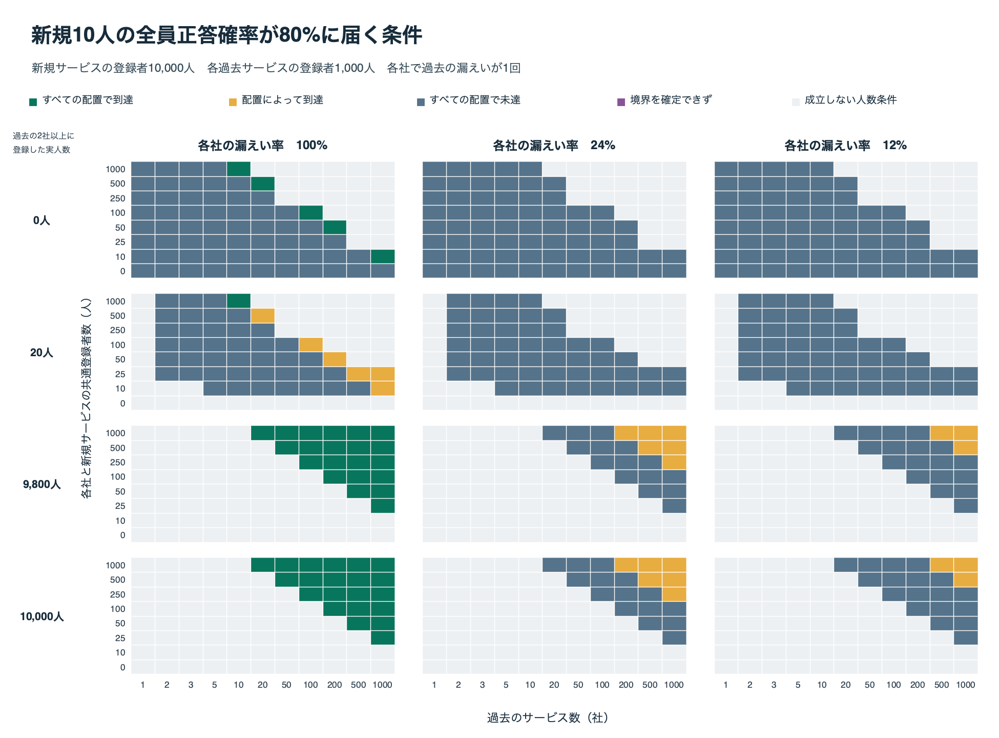

# サービス数と共通登録者数を変えると、10人全員を正答できるか

新規サービスの架空登録者1万人を1,000人ずつ10群に分け、過去の各社に1群ずつ順番に割り当てた。各社で1回ずつ漏えいが起きるとき、無作為に選んだ新規10人を全員正答できる確率が初めて80%に届いたのは、**各社の漏えい率24%で140社、12%で299社**だった。

各社が誰と登録者を共有するかでも結果は変わる。例えば200社が新規サービスと各1,000人を共有し、各社で24%が漏えいするとする。新規サービスのうち過去2社以上に登録した人が9,756人なら、どの配置でも80%未満だった。**9,757人になると80%に届く配置が初めて現れた。** 以下では、登録配置を決めたときの確率と、集計人数から判定できる範囲を示す。[実験計画](多サービス実験計画.md)

## 各社に異なる群を順番に割り当てたときの境界

各社の1,000人から120人、240人または1,000人を無作為に選んだ。社内では重複を許さず、会社どうしの事故は独立とした。同じ人が複数回漏えいしても正答人数には1人と数える。全社で同じ一意のメールを使い、漏えい行の本人が分かる条件である。

| 各社の漏えい率 | 境界の1社手前の厳密値 | 初めて80%に届いた厳密値 | 到達点での反復結果（95%信頼区間） |
|---|---:|---:|---:|
| 100% | 9社で34.8504% | **10社で100%** | 10,000 / 10,000（99.9616〜100%） |
| 24% | 139社で79.9515% | **140社で80.5071%** | 1,610,478 / 2,000,000（80.4690〜80.5787%） |
| 12% | 298社で79.8985% | **299社で80.1396%** | 1,602,587 / 2,000,000（80.0740〜80.1846%） |

1社を追加すると同じ名簿に過去の事故を1件加えることになるため、この配置での確率は単調に増加する。群ごとの非復元抽出を組み合わせて正確な分数で80%と比較し、1〜1,000の整数の中で最初の到達点を決めた。10社・100%は10群がすべて出そろう条件である。[厳密値のCSV](multiservice-balanced.csv)

境界を求めた後、139、140、298、299社を新しいシードで各200万回抽選した。139社・24%では79.9758%（79.9203〜80.0312%）で、200万回でも信頼区間が80%をまたいだ。298社・12%は79.8983%（79.8427〜79.9537%）だった。4配置×3漏えい率の12点すべてで厳密値は点ごとの95% Wilson信頼区間に収まった。同じシードを配置と漏えい率の間で共有したため、12点を独立の観測とは数えない。[200万回の確認結果](multiservice-boundary-confirm.csv)

## 誰が何社に登録したかを集計からしか知らない場合

過去のサービス数を1〜1,000社、各社と新規サービスの共通登録者数を0〜1,000人とした。各社同数の88設計に、半数が50人・半数が150人となる10設計を加えた。奇数社の場合は1社が100人。各設計で、過去2社以上に登録した新規サービスの実人数 $D$ を実現可能な全整数で動かした。表の分母は98設計を通じた **311,815通りの設計と人数の組み合わせ**である。各条件の出現頻度は仮定していない。

| 各社の漏えい率 | どの配置でも80%未満 | 配置によって80%をまたぐ | どの配置でも80%以上 |
|---|---:|---:|---:|
| 100% | 73,830 | 232,596 | 5,389 |
| 24% | 310,138 | 1,677 | 0 |
| 12% | 311,094 | 721 | 0 |

調べた全条件で3通りのいずれかに判定できた。「配置によってまたぐ」条件では、80%未満の配置と80%以上の配置が、同じ社数・各社との共通人数・$D$ を満たす。[全記録を使った場合の区間](multiservice-bounds.csv)・[部分漏えいの場合の区間](multiservice-leak-bounds.csv)



**漏えい率24%・200社・各社1,000人**では、$D$ の実現可能な範囲は955〜10,000人である。9,756人では最も有利な配置の確率も79.95983%以下だった。9,757人になると80.011998%以上を達成する配置が存在した。12%に下げると、この200社の条件ではどの $D$ でも80%に届かなかった。500社・各社1,000人の場合は、12%で $D=9,766$ 人から、24%で $D=9,710$ 人から到達できる配置が現れた。

## 延べ人数が同じでも結果が変わる理由

延べ1万人の共通登録枠を用意し、過去2社以上に登録した人をちょうど20人に固定した。以下は100%漏えいの結果である。上限を達成するには、20人を各2社だけに登録させ、残りの枠を別々の人に割り当てる。下限を達成するには、20人にできる限り多くの枠を割り当てる。

| サービス数 × 1社の共通人数 | 過去のどこかに登録した実人数 | 10人全員正答確率の範囲 | 下限の配置で全員正答した回数 |
|---|---:|---:|---:|
| 10社 × 1,000人 | 9,820〜9,980人 | **83.38〜98.02%** | 8,321 / 10,000 |
| 20社 × 500人 | 9,620〜9,980人 | 67.87〜98.02% | 6,735 / 10,000 |
| 100社 × 100人 | 8,020〜9,980人 | 11.00〜98.02% | 1,074 / 10,000 |
| 1,000社 × 10人 | 20〜9,980人 | 約 $6.73\times10^{-27}$ %〜98.02% | 0 / 10,000 |

この延べ1万人の系列を12%または24%漏えいにすると、すべての配置が80%未満になる。漏えいした共通登録枠は平均で1,200件または2,400件であり、漏えいした実人数はその件数以下である。無作為に選んだ1人の正答確率だけを見ても、それぞれ最大12%または24%なので、10人全員の確率もそれを超えない。[39配置を各1万回抽選した結果](multiservice-leaks.csv)

同じ100社×100人でも、複数登録者数を動かすと判定が変わる。100%漏えいでは、$D$ が0〜2人ならどの配置でも80%以上、3〜220人なら配置次第、221〜5,000人ならどの配置でも80%未満だった。延べ登録数が固定されているため、重複が増えるほど過去のどこかに登場できる実人数の上限が下がる。

**各社の共通人数に差がある場合**にも、平均だけでは判定できない。100%漏えい、200社、平均100人、$D=52$ 人で比較すると、全社一律100人なら全員正答確率は70.16〜100%だった。半数の会社が50人、半数が150人なら86.14〜100%となり、80%を保証できる。150枠を持つ各社は、複数登録の52人を全員使っても、さらに98人の単独登録者を必要とするためである。

## 計算法と検算

**全記録を使う場合。** $N=10,000$、各社の共通登録者数を $c_i$、延べ人数を $S=\sum_i c_i$ とする。過去のどこかに現れる実人数 $M$ の最小・最大は次の式で求まる。

$$
M_{\min}=D+\sum_i\max(c_i-D,0),\qquad M_{\max}=\min(N,S-D).
$$

下限が上限を超える $D$ は実現不能である。各社で $D$ 人に収まらない枠はすべて別の単独登録者を必要とし、複数登録者の1人につき少なくとも1枠は重複する。両端は、複数登録者のために選んだ枠を $D$ 人に順番に割り振り、残りを1人ずつに割り当てて実現できる。10人の全員正答確率は $F(M)=\binom{M}{10}/\binom{N}{10}$ で、80%に初めて届くのは $M=9,780$ 人である。[上下限の計算](../scripts/multiservice-bounds.rb)

**部分漏えいの場合。** $d$ 社に登録した1人が少なくとも1回漏えいする確率は、各社の漏えい率を $q$ とすると $1-(1-q)^d$ である。これを全員分足すと、漏えいに現れる実人数の期待値になる。期待値を最大にするには、まず登場し得る実人数を $M_{\max}$ にする。重複した1枠を未登録者に移すと、元の人の正答確率の減少より新しい人の増加が大きいからである。さらに、複数登録者用の $S-(M_{\max}-D)$ 枠を $D$ 人にできるだけ等しく割り振る。個人の登録先が増えるほど1枠追加の効果が小さくなるためである。各社の複数登録者用の枠数を決めてから、その枠を $D$ 人に巡回して配るとこの配置を実現できる。$D=0$ なら全枠が単独登録になる。

この最大期待値を $\mu$ とする。最も有利な配置の全員正答確率には、$F$ を整数間で線形補間した $F(\mu)$ が下界を、$(\mu/N)^{10}$ が上界を与える。前者は、実際に漏えいした実人数を $X$ とすると全員正答確率が $E[F(X)]$ となり、$F$ が凸であるため成り立つ。後者は、社内の非復元抽出で生じる負の関連性が各人の「少なくとも1度登場」にも保たれることと、異なる10人の登場確率の積の平均が算術平均の10乗以下であることによる。個人の確率を独立と置かずに80%と比較した。[部分漏えいの計算](../scripts/multiservice-leak-bounds.rb)・[負の関連性と非復元抽出、Joag-Dev・Proschan（1983）](https://doi.org/10.1214/aos/1176346079)

各条件に80%未満の配置も存在することは、登録を一部の人に集めて確かめた。各社の複数登録枠を $\min(c_i,D)$ とし、最初の同じ人たちから順に埋める。2社に満たない人がいれば、3社以上を持つ人から、その人がまだ登録していない会社の枠を移す。実現可能な $D$ なら複数登録枠が合計 $2D$ 以上あり、全員が2社以上になるまで繰り返せる。この配置で3社以上に登録し得るのは最初の最大1,000人だけである。残り9,000人以上は多くても2社となる。したがって無作為な1人の正答確率も、12%なら30.304%以下、24%なら48.016%以下である。この未達の配置と、上で求めた有利な配置の上下界を組み合わせて3区分を判定した。

**10群と反復実験。** 1群から新規対象者を何人引いたかで条件を分け、その全員が少なくとも1回登場する確率を包除原理で求めた。10群で合計10人となるすべての組み合わせを、各群からの選び方の数で重みづけした。反復実験では別のRustプログラムを使い、新規10人を先に選んで、各社の1,000人中でこの10人が占める抽選順位だけを非復元抽出した。全員を生成してから新規の10人を調べる方法と同じ同時分布である。小規模な名簿については全登録配置や全漏えいの組み合わせを直接列挙し、上下限と10群で用いた確率式を検算した。[10群の厳密計算](../scripts/multiservice-balanced.rb)・[反復実験](../examples/multiservice_leaks.rs)

## 再現方法

プロジェクト直下で実行する。RubyとRustの既存依存を使う。図の再生成にはgnuplotが必要である。

```sh
study=$(mktemp -d)
ruby scripts/multiservice-bounds.rb > "$study/multiservice-bounds.csv"
ruby scripts/multiservice-leak-bounds.rb > "$study/multiservice-leak-bounds.csv"
ruby scripts/multiservice-balanced.rb > "$study/multiservice-balanced.csv"
cargo run --release --locked --example multiservice_leaks -- --output "$study/multiservice-leaks.csv"
cargo run --release --locked --example multiservice_leaks -- --boundary-confirm --output "$study/multiservice-boundary-confirm.csv"
for name in bounds leak-bounds balanced leaks boundary-confirm; do
  cmp "$study/multiservice-$name.csv" "docs/multiservice-$name.csv" || exit 1
done
gnuplot -c scripts/plot-multiservice.gp "$study/multiservice-bounds.csv" "$study/multiservice-leak-bounds.csv" "$study/multiservice-map.png"
```

従来の2サービス実験では、両社に登録した人の半数が同じメールを使った。今回の境界は、共通登録者全員が同じ一意のメールを使い、過去の漏えい行はすべて本人と対応づくと仮定した値である。対象者は各回10人、過去の事故は各社1件とした。[従来の2サービス実験](全員正答確率の反復実験.md)
