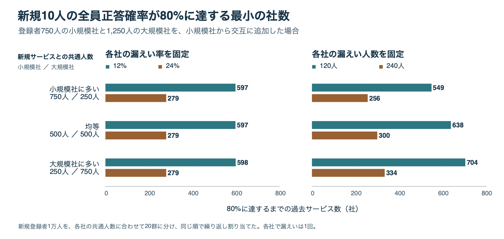

# 会社の規模と共通登録者数を変えると、80%の境界はどう動くか

登録者750人と1,250人の過去サービスを交互に加えた。2社が新規サービスと共有する延べ人数を1,000人にそろえたとき、**各社の24%が漏えいすると、共通人数の配分を変えた3条件とも279社で80%に到達した。各社から一律240人が漏えいすると、境界は256社から334社まで開いた。** いずれも2社合計の漏えいは480人である。

新規サービスの架空登録者1万人から10人を無作為に選んだ。10人それぞれが一度でも過去の漏えいに登場すれば、同じ一意のメールから本人に対応づけられると仮定した。1人でも保留なら、その回は全員正答の失敗に数えた。各社では名簿から決めた人数を無作為に非復元抽出し、会社間の漏えいは独立とした。[実験計画](規模の異なるサービスの実験計画.md)

## 共通人数の合計をそろえて、大小どちらに配るかを変える

下の表は、1万人を順番に各社の共通登録枠に割り当て、一巡したら同じ群を再び割り当てる条件の結果である。750人の会社から始めた。社数は、10人全員の正答確率が初めて80%以上になる点を表す。

| 新規サービスと共通の人数（小規模社・大規模社） | 各社12%漏えい | 各社24%漏えい | 各社120人漏えい | 各社240人漏えい |
|---|---:|---:|---:|---:|
| 750人・250人 | 597社 | 279社 | 549社 | 256社 |
| 500人・500人 | 597社 | 279社 | 638社 | 300社 |
| 250人・750人 | 598社 | 279社 | 704社 | 334社 |

一律240人の場合、小規模社に登録した人がその事故に含まれる確率は240/750 = 32%、大規模社では240/1,250 = 19.2%となる。小規模社に共通登録者を多く置くと、より多くの人が1回あたり32%の抽選を受け、境界が78社早まった。一律120人ではこの差が155社になった。各社24%の場合はどちらの会社に登録しても1回あたりの確率が等しい。279社時点での全員正答確率は上から80.368%、80.229%、80.090%で、社数が一致しても確率には小さな差が残った。

一律240人の境界を1社ずつ確かめると、750人・250人では255社で79.882%、256社で80.186%。均等配分では299社で79.690%、300社で80.087%。250人・750人では333社で79.803%、334社で80.192%だった。大規模社から始めると最小社数は順に256社、299社、333社となり、配分による順位は同じだった。[開始順を含む全90条件の結果](service-size-cycles.csv)



## 前回の各社1,000人から、何を変えると境界が動いたか

前回の基準では、全員が新規サービスとも共通の各社1,000人で、24%漏えいの境界は140社だった。次の表では小さい会社を先に加えた。同規模の場合は表の左側の会社を先にした。

| 各社の登録者（A・B） | 新規サービスと共通（A・B） | 各社24% | 各社240人 |
|---|---|---:|---:|
| 1,000人・1,000人 | 1,000人・1,000人 | 140社 | 140社 |
| 500人・1,500人 | 500人・1,500人 | 140社 | 204社 |
| 1,000人・1,000人 | 500人・500人 | 279社 | 279社 |
| 750人・1,250人 | 500人・500人 | 279社 | 300社 |
| 750人・1,250人 | 250人・250人 | 557社 | 600社 |

名簿を各社1,000人に固定したまま、共通人数だけを各社1,000人から500人に減らすと、24%の境界は140社から279社へ動いた。次に共通人数を500人に保って名簿を750人・1,250人に変えると、24%の境界は279社、一律240人の境界は300社になった。さらに同じ大小の名簿で共通人数を各250人に減らすと、それぞれ557社、600社まで増えた。共通登録者が少ないほど、1万人を一巡させるのに多くの会社を要する。[前回の実験](多サービス実験結果.md)・[全条件](service-size-cycles.csv)

## 各人の登録先を自由に割り当てれば、最短何社で到達できるか

共通登録者を毎回同じ群で循環させる制約を外し、各社の規模、共通人数、漏えい人数をそろえたまま、80%に届く配置が初めて存在する社数を求めた。ここでも小規模社から交互に加え、名簿は漏えいする前に決める。

| 共通人数（小・大） | 一律120人で到達可能な最小社数 | 一律240人で到達可能な最小社数 | 一律240人で同じ群を循環させた場合 |
|---|---:|---:|---:|
| 750人・250人 | 489社 | **223社** | 256社 |
| 500人・500人 | 555社 | **255社** | 300社 |
| 250人・750人 | 640社 | **298社** | 334社 |

例えば均等配分・一律240人では、254社で最も有利に割り当てても全員正答確率は79.81%未満である。255社では80%を超える名簿を構成できる。循環配置では、何度登録しても小規模社の事故だけを経験する群と、大規模社の事故だけを経験する群に分かれる。人ごとに両方の会社への登録を割り振れば、10人の中に過去の記録に現れにくい人が含まれる確率を下げられる。[6条件の必要社数と到達を証明する確率の上下界](service-size-best-layout.csv)

最小性は、到達できる名簿を1つ示し、その1社手前でどの名簿も到達できないことを示して確かめた。前者では、A社・B社への登録回数を人ごとに割り当て、各社の共通人数に合う名簿を構成した。後者では、各人が一度も漏えいしない確率の相乗平均が、各社の共通人数と漏えい率だけで決まることを使った。相加相乗平均と非復元抽出の負の関連性から、全員正答確率は「1からその相乗平均を引いた値」の10乗以下になる。社数を増やすと既存の名簿を保ったまま1社を足せるので、それより前の社数もすべて未達である。

**各社の24%が漏えいする場合は、登録先を自由に選んでも3配分とも最短279社だった。** 278社では3配分のいずれも延べ139,000枠である。1人が少なくとも一度登場する確率は登録社数が増えるほど伸びが小さくなるため、9,000人を14社ずつ、1,000人を13社ずつに割り当てたときに登場実人数の期待値が最大になる。このときも全員正答確率は $[1-0.9(0.76)^{14}-0.1(0.76)^{13}]^{10}$ 以下、すなわち79.953%未満である。279社では最初の表の循環名簿が実際に80%を超える。

## 300社に固定して、必要な共通人数を求める

各社が独立に、新規登録者1万人から共通登録者を選ぶ場合も計算した。同じ人が複数社に選ばれることも、どこにも選ばれないこともある。表は小規模社150社と大規模社150社、各社240人漏えいの結果である。各行の配分比を保ち、80%に達する最小の整数人数を求めた。延べ登録枠は、同じ人が複数社に登録した回数を重ねて数える。

| 共通人数の配分（小：大） | 小規模社1社あたり | 大規模社1社あたり | 300社の延べ共通登録枠 | 到達点の全員正答確率 |
|---|---:|---:|---:|---:|
| 3対1 | 657人 | 219人 | 131,400枠 | 80.100% |
| 1対1 | 494人 | 494人 | 148,200枠 | 80.107% |
| 1対3 | 282人 | 846人 | 169,200枠 | 80.046% |

**同じ300社、同じ共通人数でも、誰を各社に割り当てるかで80%判定は逆転した。** 750人・250人が共通で各社24%漏えいのとき、順番に群を割り当てると全員正答確率は84.844%、各社が独立に選ぶと76.377%だった。小規模社の登録者750人を全員共通にしても、独立抽選で3対1を保つ条件では80%に届かない。独立抽選の75条件では44条件が到達し、31条件は各社の定員いっぱいまで配分比に沿って共通人数を増やしても未達だった。[独立に名簿を作る75条件の結果](service-size-random.csv)

## 実際の登録先が分からない場合に判定できること

過去のどれか2社以上に登録している新規サービスの**実人数**を $D$ とした。各社の共通人数と $D$ だけを知り、個別の登録先が分からないとき、全員正答確率には幅がある。750人・1,250人の各社と新規サービスの共通人数が250人・750人で、全社24%漏えいの場合を示す。280社・300社とも、共通人数の大小を入れ替えても表の境界は同じだった。

| 過去の社数 | どの登録配置でも80%未満となる $D$ | 配置次第で80%に届く $D$ |
|---|---:|---:|
| 200社 | 実現可能な全範囲（657〜10,000人） | 該当なし |
| 280社 | 684〜9,990人 | 9,991〜10,000人 |
| 300社 | 688〜9,916人 | 9,917〜10,000人 |

したがって「300社、過去2社以上への登録者が9,917人」は、到達可能な最初の点である。同じ人数でも80%を下回る配置が存在する。調べた12社数・9設計において、各社の12%または24%が漏えいする場合に、人数だけから80%を保証できた条件はなかった。[実現可能な人数の全区間](service-size-bounds.csv)

一律240人では、**同じ223社、同じ共通人数（小750人・大250人）、同じ $D=10{,}000$ 人でも、80.22%以上に届く配置と、0.16%未満にとどまる配置の両方がある。** 後者は、最初の40社で全員を2回ずつ登録させ、その後は小規模社に2回登録していた750人だけで各社の共通枠を埋める。残りの6,750人は小規模社で2回、2,500人は大規模社で2回しか機会がない。このとき無作為な1人の正答確率は52.4664%以下で、10人全員の確率はその10乗以下になる。社数と「2社以上に登録した実人数」が同じでも、3社目以降の登録機会が何人に分散したかが結果を左右する。[到達する配置と未達となる配置の検算](service-size-best-layout.csv)

## 計算と検証

循環配置では同じ群の複数人が同時に漏えいする確率を、社内の非復元抽出と包除原理から計算した。全員正答の確率を有理数で評価し、到達社数とその1社前を80%と比較した。独立に作る名簿では登録者の抽選も計算に含め、確率の上下限を外向きに丸めて80%を判定した。部分識別では前回と同じく、各人の登場確率、非復元抽出の負の関連性、実際に漏えいした実人数に対する全員正答確率の凸性を使って到達可能性を判定した。[前回の導出](多サービス実験結果.md)・[負の関連性についての原論文](https://doi.org/10.1214/aos/1176346079)

小さい名簿では抽選の全通りを列挙して照合した。本実験でも、別の組合せ計算で循環配置の90境界がすべて一致した。独立な名簿の結果は、指定した人たちのうち何人が1社に登録したかで場合分けする別式で、全75条件の人数上限と到達点前後の計163確率を照合した。

さらに、循環配置16条件で境界直前と到達点をそれぞれ20万回抽選した。同一条件の前後は同じ抽選を使っている。32点のうち24点で点ごとの95% Wilson区間が厳密値を含み、16点で区間が80%をまたいだ。厳密値が区間外だった8点はいずれも12%条件で、実測が厳密値を最大0.2901ポイント下回った。条件間でシードを共有しているため、これらのずれは相関する。上の表の社数は厳密計算で決めた。この境界は、一意の同じメールを使う架空名簿と、指定した事故の抽選・登録配置に対する値である。[反復ごとの設定と32点の集計](service-size-simulation.csv)

リポジトリのルートで次を実行すると、5つのCSVと比較図を新しい一時ディレクトリに再生成できる。図のバイト比較には同じ描画環境を使う。

```sh
study=$(mktemp -d)
ruby scripts/service-size-cycles.rb > "$study/service-size-cycles.csv"
ruby scripts/service-size-bounds.rb > "$study/service-size-bounds.csv"
ruby scripts/service-size-best-layout.rb > "$study/service-size-best-layout.csv"
ruby scripts/service-size-random.rb > "$study/service-size-random.csv"
ruby scripts/confirm-service-sizes.rb "$study/service-size-cycles.csv" "$study/service-size-simulation.csv"
gnuplot -c scripts/plot-service-size.gp "$study/service-size-cycles.csv" "$study/service-size-boundaries.png"
for item in service-size-cycles.csv service-size-bounds.csv service-size-best-layout.csv service-size-random.csv service-size-simulation.csv service-size-boundaries.png; do
  cmp "$study/$item" "docs/$item" || exit 1
done
```
